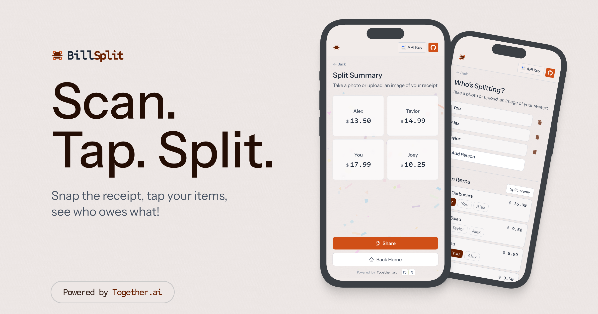

  

    
🌐 Language

    

      

        <a href="https://openaitx.github.io/view.html?user=Nutlope&project=billsplit&lang=en">English</a>
        | <a href="https://openaitx.github.io/view.html?user=Nutlope&project=billsplit&lang=zh-CN">简体中文</a>
        | <a href="https://openaitx.github.io/view.html?user=Nutlope&project=billsplit&lang=zh-TW">繁體中文</a>
        | <a href="https://openaitx.github.io/view.html?user=Nutlope&project=billsplit&lang=ja">日本語</a>
        | <a href="https://openaitx.github.io/view.html?user=Nutlope&project=billsplit&lang=ko">한국어</a>
        | <a href="https://openaitx.github.io/view.html?user=Nutlope&project=billsplit&lang=hi">हिन्दी</a>
        | <a href="https://openaitx.github.io/view.html?user=Nutlope&project=billsplit&lang=th">ไทย</a>
        | <a href="https://openaitx.github.io/view.html?user=Nutlope&project=billsplit&lang=fr">Français</a>
        | <a href="https://openaitx.github.io/view.html?user=Nutlope&project=billsplit&lang=de">Deutsch</a>
        | <a href="https://openaitx.github.io/view.html?user=Nutlope&project=billsplit&lang=es">Español</a>
        | <a href="https://openaitx.github.io/view.html?user=Nutlope&project=billsplit&lang=it">Italiano</a>
        | <a href="https://openaitx.github.io/view.html?user=Nutlope&project=billsplit&lang=ru">Русский</a>
        | <a href="https://openaitx.github.io/view.html?user=Nutlope&project=billsplit&lang=pt">Português</a>
        | <a href="https://openaitx.github.io/view.html?user=Nutlope&project=billsplit&lang=nl">Nederlands</a>
        | <a href="https://openaitx.github.io/view.html?user=Nutlope&project=billsplit&lang=pl">Polski</a>
        | <a href="https://openaitx.github.io/view.html?user=Nutlope&project=billsplit&lang=ar">العربية</a>
        | <a href="https://openaitx.github.io/view.html?user=Nutlope&project=billsplit&lang=fa">فارسی</a>
        | <a href="https://openaitx.github.io/view.html?user=Nutlope&project=billsplit&lang=tr">Türkçe</a>
        | <a href="https://openaitx.github.io/view.html?user=Nutlope&project=billsplit&lang=vi">Tiếng Việt</a>
        | <a href="https://openaitx.github.io/view.html?user=Nutlope&project=billsplit&lang=id">Bahasa Indonesia</a>
      

    

  

    <h1 >BillSplit</h1>
    

        A modern bill splitting app. Powered by Together.ai.
    

## Tech Stack

- Next.js 15 with App Router for modern web development
- Together.ai for advanced LLM capabilities
- Helicone for LLM observability and monitoring
- Amazon S3 for secure image storage
- Vercel for seamless deployment and hosting

## How it works

1. User uploads a picture of the bill
2. The app processes the PDF using Together.ai with Vision models and Json mode
3. The app let the user choose how to split items and add people names
4. The app displays the final summary with the split of the bill

## Cloning & running

1. Fork or clone the repo
2. Create an account at https://togetherai.link for the LLM
3. Create an account at https://aws.amazon.com/ for the S3 bucket
4. Create a `.env` (use the `.example.env` for reference) and replace the API keys
5. Run `pnpm install` and `pnpm run dev` to install dependencies and run locally
